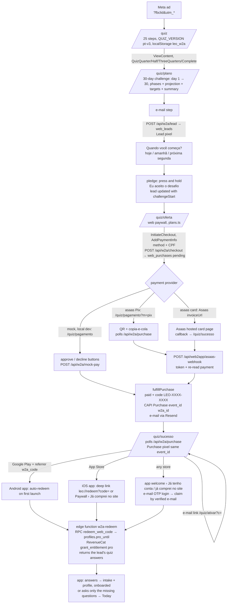

# Web2app funnel — leodiet.com/quiz

Meta ad → quiz (PT-BR) → personalized plan → e-mail → web paywall → payment → code → app download → app redeems the code.

Status (2026-10-27): built on branch `web2app` (this repo) + `web2app-redeem` (repo `leo`). Payment gateway: **Asaas**
(Pix inline + card on the Asaas hosted invoice), `PAYMENT_PROVIDER=asaas`; the `mock` provider stays for local dev.
Not merged, not live: the webhook still has to be created in the Asaas portal and the env vars set on Vercel (section
"Asaas"). The `/lp-*` landings are untouched.

## Flow



Why the entitlement is granted at **redemption**, not at payment: the RevenueCat app user id is the app's Supabase user
id (anonymous until the user signs in), which doesn't exist when the person pays on the web. Granting to a placeholder
id would force a `Purchases.logIn` and break the anonymous-session design. So the code is the bridge: it attaches the
purchase to whatever user the app has at that moment (up to 3 users per code → 3 phones / re-installs).

## The 30-day challenge framing (pt-v3, 2026-10-29)

The quiz is sold as the **Desafio Carnívoro de 30 dias**: intro eyebrow, loading ("Montando o seu desafio…"), plan
screen (day 1 → day 30 dates, estimated weight on day 30 for weight loss, phases semana 1 adaptação / semanas 2–3
ritmo / semana 4 resultado, then the long-term projection as "E depois do dia 30"). After the e-mail, two commitment
screens on `/quiz/plano` before any price: **Quando você começa?** (`answers.challengeStart` YYYY-MM-DD local,
`challengeStartPick` today|tomorrow|monday) and the **pledge** (name, date range, "Eu me comprometo a…" lines from the
blockers, `HoldButton` in `ui.tsx`: 1.5 s hold, keyboard Space/Enter hold, a quick tap shows "Segure para confirmar",
assistive-tech click accepts). Accepting sets `challengeAcceptedAt` and `commit: "30"` (the old 7/30/90 question is
gone) and re-POSTs the lead with the same `leadId` (fire and forget). The paywall title becomes "{nome}, seu desafio
começa {hoje|amanhã|na segunda, 3 de novembro}" (or "entre no desafio" with no / past start date); each plan shows
"Desafio + app por N meses / para sempre". `/quiz/oferta` still works without the pledge (buyers coming back from an
e-mail or an expired Pix). Helpers and copy: `lib/web2app/challenge.ts`. The new answer keys are ignored by the app
(`webProfile.ts` reads only known keys; nothing checks `quiz_version`).

PostHog: `w2a_challenge_start_view`, `w2a_challenge_start_picked {start}`, `w2a_challenge_pledge_view`,
`w2a_challenge_accepted {start}`; `w2a_paywall_view` carries `accepted`. Nothing new goes to the pixel.

## Files

**This repo (carnivoresystem-web)**

| File | What |
|---|---|
| `middleware.ts` | `/quiz/*` gets header `x-w2a: 1` (layout: pt-BR, no site header). `/` rewrite for leodiet.com unchanged. |
| `app/layout.tsx` | reads `x-w2a`. |
| `app/quiz/layout.tsx` | metadata (noindex), theme color, `FunnelBoot` (pixel). |
| `app/quiz/page.tsx` | quiz. |
| `app/quiz/plano/page.tsx` | plan screen + e-mail step. |
| `app/quiz/oferta/page.tsx` | web paywall. |
| `app/quiz/pagamento/page.tsx` | `?m=pix`: Pix QR page · `?m=card`: card in a new tab (only when Asaas can't redirect back) · no `m`: mock checkout. |
| `app/quiz/sucesso/page.tsx` | confirmation, code, store buttons, deep link, e-mail me the code. |
| `app/quiz/ativar/page.tsx` | `/quiz/ativar?c=CODE` — the link in the e-mail. |
| `components/w2a/*` | UI: `ui.tsx` (building blocks), `quiz.tsx`, `plan.tsx`, `paywall.tsx` (plans, Pix/cartão, CPF), `checkout.tsx` (Pix QR + polling, card wait, expired / refused states), `mock-checkout.tsx`, `success.tsx`, `activate.tsx`. |
| `lib/web2app/quiz.ts` | **the questions** (`STEPS`), milestones, validation. Bump `QUIZ_VERSION` when you change them. |
| `lib/web2app/plans.ts` | **prices** (BRL, cents). Edit here; the server re-reads them on checkout (the browser never sets the price). |
| `lib/web2app/challenge.ts` | 30-day challenge: start options, day 1 → 30 dates, kg on day 30, phases, pledge lines. |
| `lib/web2app/projection.ts` | weight projection (conservative: 0.5–0.9 %/week, capped 0.9 kg/week, slows at the end, BMI floor 18.5) + daily water/sodium (mirrors the app's `computeTargets`). |
| `lib/web2app/state.ts` | funnel state in localStorage `leo_w2a` + first-touch attribution (fbclid → fbc, `_fbp`, utm_*). |
| `lib/web2app/pixel.ts` | Meta Pixel (loads only on `*.leodiet.com`, or anywhere with `?pixel=1`). |
| `lib/web2app/links.ts` | App Store / Play (with `w2a_code` referrer) / deep link URLs. |
| `lib/web2app/payments/types.ts` | **`PaymentProvider` interface**. |
| `lib/web2app/payments/asaas.ts` | **Asaas provider**: customer by CPF, one-time Pix / card charge, Pix QR, webhook verification, status, cancel. |
| `lib/web2app/payments/mock.ts` | mock provider (local dev only). |
| `lib/web2app/payments/index.ts` | provider registry (`PAYMENT_PROVIDER`, old name `W2A_PAYMENT_PROVIDER` still read), mock blocked in production. |
| `lib/web2app/cpf.ts` | CPF mask + check digits (browser and server). The CPF is sent to Asaas only, never stored by us. |
| `lib/web2app/server/fulfill.ts` | the one place a purchase becomes paid (idempotent): code, CAPI, e-mail. `markPurchase()` (conditional transitions, refund → revoke). |
| `lib/web2app/server/revoke.ts` | refund / chargeback: `profiles.pro_until` + RevenueCat revoke for every user who redeemed the code. |
| `lib/web2app/server/webhook.ts` | shared webhook handler (verify → fulfill / mark). |
| `lib/web2app/server/capi.ts` | Conversions API Purchase (`event_id = w2a_<purchaseId>`, same as the browser pixel → deduplicated). |
| `lib/web2app/server/email.ts` | code e-mail (Resend, from `leo@leodiet.com`). |
| `lib/web2app/server/db.ts` | Supabase PostgREST with the service role (server only). |
| `app/api/w2a/lead` | POST: create/update the lead. |
| `app/api/w2a/checkout` | POST: pending purchase + `provider.createCheckout()` (`method`, `cpf`, `replace` = previous unpaid attempt, canceled at the gateway). |
| `app/api/w2a/purchase` | GET `?pid&t[&check=1]`: purchase status + `reason` (`pix_expired`, `card_refused`, `canceled`) for the buyer's browser (token-checked). `check=1` (every ~15 s) also asks the gateway. |
| `app/api/w2a/mock-pay` | POST: mock approve/decline (refused unless provider = mock). |
| `app/api/w2a/email-code` | POST: (re)send the code, max 5, can correct the e-mail. |
| `app/api/web2app/asaas-webhook` | POST: **Asaas webhook** (the URL to register in the portal). |
| `app/api/w2a/webhook/[provider]` | POST: generic gateway webhooks → `provider.parseWebhook()` → fulfill / mark (`/api/w2a/webhook/asaas` works too). |
| `scripts/w2a-fake-asaas.mjs` | fake Asaas API for local tests (no network, no money). |

**Repo leo (branch `web2app-redeem`)**

| File | What |
|---|---|
| `supabase/migrations/20261027000000_web2app.sql` | `web_leads`, `web_purchases`, `web_redemptions` (RLS on, no policies: service role only), RPC `redeem_web_code`. **Already applied to prod.** |
| `supabase/functions/w2a-redeem/index.ts` | redeem endpoint (user JWT). **Already deployed.** Grants `profiles.pro_until` + RevenueCat entitlement `pro` (API v2, promotional grant, `expires_at` = plan end; lifetime = 2100-01-01). |
| `src/lib/webRedeem.ts` | app client: normalize, redeem, e-mail claim (`claimWebPurchases`), pending code from the install referrer. |
| `src/lib/webProfile.ts` | quiz answers → `settings.intake` + `settings.profile` (mapping below); `applyWebAnswers` never touches an onboarded install. |
| `src/app/redeem.tsx` | "Ativar compra do site" modal (`leo://redeem?code=`; paywall footer "Já comprei no site"); success on a fresh install applies the answers. |
| `src/app/onboarding.tsx` | welcome screen (first launch: "Começar" + "Já tenho conta / já comprei no site" → e-mail OTP → claim); `mode=complete&ask=…` asks only missing questions. |
| `src/app/_layout.tsx` | `/redeem` allowed through onboarding/paywall gates; Android auto-redeem after reading the referrer, then applies the answers; claim safety net for signed-in non-Pro users. |
| `src/lib/attribution.ts` | reads `w2a_code` from the Play install referrer. |

## Data

- `web_leads`: e-mail, name, quiz answers (jsonb), computed plan, attribution (fbclid/fbc/fbp/utm/landing/referrer/IP/UA), `marketing_ok`.
- `web_purchases`: plan, amount, provider + `provider_ref`, status (`pending|paid|failed|refunded|canceled`), `test`, `access_token` (lets the buyer's browser read the status), `code`, `redemptions/max_redemptions`, CAPI and e-mail bookkeeping.
- `web_redemptions`: one row per (purchase, app user): platform, app version, `pro_until`, RevenueCat result.

## App side: e-mail claim and profile from the quiz

- `w2a-redeem` has two modes. `{code}`: as before. `{claim: true}`: needs a signed-in, **verified** (non-anonymous, `email_confirmed_at`) user; finds every `paid` `web_purchases` row whose e-mail matches case-insensitively, redeems each through `redeem_web_code` (same idempotency and 3-users limit), grants RevenueCat once with the longest `pro_until`. Results: `ok` (`already` when this user had redeemed), or `none | used | refunded | unverified`.
- Both modes return `answers` + `quiz_version`: the purchase's lead, else the newest lead with the same e-mail.
- No purchase on the e-mail: the user stays signed in, sees a friendly message and continues to the normal onboarding (a returning account that is already onboarded goes home).
- Apple "Hide my e-mail" addresses won't match the e-mail used on the web: those buyers use the code.

Mapping (web quiz id → app), source of truth `leo/src/lib/webProfile.ts`:

| Web answer | App field |
|---|---|
| `activity` sedentary / light / moderate / active | `profile.training` none / none / moderate / heavy |
| `salt` table / fine-sea / coarse / kosher / none | `profile.saltType` (same ids) |
| `tenure` never / restart / new / months / veteran | `intake.tenure` not-started / not-started / under-4w / 1-6m / over-6m → `profile.tenure` new (first two) or adapted |
| `sex` | `intake.sex` |
| `weightKg` | `profile.weightKg` |
| `symptoms` (app preset ids, "none" = empty) | `intake.symptoms`; cramps → `profile.crampsOften` |
| `goal` lose / energy / cravings / digestion / health / muscle | `intake.goals` weight / energy / discipline / digestion / inflammation / energy |
| `targetKg` vs `weightKg` (±1 kg), goal muscle | `intake.weightGoal` lose / maintain / gain |
| `blockers` sweets / weekends / symptoms / consistency, no-results | `intake.struggles` cravings / weekends / symptoms / consistency |
| `pastDiets` (anything but none) | `intake.triedBefore` |
| `commit` 7 / 30 / 90 (pt-v2) · "30" once the challenge is accepted (pt-v3) | `intake.commitDays` 7 / 30 / 30 |
| `challengeStart`, `challengeStartPick`, `challengeAcceptedAt` (pt-v3) | not read by the app (yet) |
| — | `intake.source = 'web'` |

`computeTargets` needs training, tenure, salt, weight, sex and symptoms. If any is missing (pt-v1 leads had no salt/symptoms, or no lead at all) the app opens `/onboarding?mode=complete&ask=…` with only those questions, then Today. Quiz ids must stay in sync with the app; bump `QUIZ_VERSION` when they change.

Quiz answers are health data: they stay in Supabase and are **never** sent to Meta (CAPI gets hashed e-mail, external_id, country, fbc/fbp/IP/UA and the value only).

## Env vars (Vercel)

| Var | Needed | Notes |
|---|---|---|
| `SUPABASE_URL` | yes | Leo project. |
| `SUPABASE_SERVICE_ROLE_KEY` | yes | server only (never `NEXT_PUBLIC_`). |
| `RESEND_API_KEY` | yes | domain leodiet.com is verified. |
| `W2A_EMAIL_FROM` | no | default `LeoDiet <leo@leodiet.com>`. |
| `PAYMENT_PROVIDER` | yes | `asaas` on Vercel; `mock` only in local dev (old name `W2A_PAYMENT_PROVIDER` still works). |
| `ASAAS_API_KEY` | asaas | **without the leading `$`** (`aact_prod_…`): the code re-adds it. See "The `$` in the key". |
| `ASAAS_ENV` | asaas | `production` or `sandbox` (default sandbox). Sandbox purchases are `test` (24 h codes, no Meta Purchase). |
| `ASAAS_WEBHOOK_TOKEN` | asaas | same value as the webhook's "Token de autenticação" in the Asaas portal (32–255 chars). |
| `ASAAS_CALLBACK` | no | `0` = never send `callback.successUrl` (if the domain isn't registered in Asaas; otherwise the code already falls back on a 400). |
| `W2A_PIX_MINUTES` | no | minutes our Pix page waits before saying "Pix expirado" (default 30). |
| `REVENUECAT_SECRET_KEY` | for refunds | v2 secret of the LeoDiet project (same as the `w2a-redeem` function, in `supabase.env`). Optional `RC_PROJECT_ID`, `RC_ENTITLEMENT_ID`. |
| `W2A_ALLOW_MOCK_IN_PRODUCTION` | no | `1` would allow the mock on the production deployment. **Never set it.** |
| `META_CAPI_TOKEN` | for CAPI | same token as the app's `meta-capi` function (dataset/pixel 1370037514985006). Without it the browser pixel still works. |
| `META_TEST_EVENT_CODE` | no | only for testing in Events Manager › Test events. Test purchases go to CAPI **only** when it is set. |

**Not set on Vercel yet** (2026-10-27): without them the preview shows the quiz, plan and paywall, but the e-mail step fails (no DB). To enable the preview (values from `~/.config/33web/supabase.env`, nothing printed):

```bash
set -a; . ~/.config/33web/supabase.env; set +a
for v in SUPABASE_URL SUPABASE_SERVICE_ROLE_KEY RESEND_API_KEY; do printf '%s' "${!v}" | vercel env add $v preview web2app; done
printf mock | vercel env add PAYMENT_PROVIDER preview web2app   # or asaas (see "Asaas › Vercel")
vercel redeploy <preview url>   # or push a commit
```

Production has none of them yet.

## Pixel / CAPI rules

- Browser: `ViewContent` (quiz start), custom `QuizQuarter/QuizHalf/QuizThreeQuarters/QuizComplete`, `Lead` (eventID `lead_<id>`), `InitiateCheckout` (paywall view), `AddPaymentInfo` (Continuar), `Purchase` with value/currency (eventID `w2a_<purchaseId>`).
- Server: CAPI `Purchase` with the same `event_id` → Meta deduplicates.
- Test purchases (mock provider, `web_purchases.test = true`): the browser Purchase fires only with `?pixel=1` in the funnel URL (sessionStorage flag), and CAPI only when `META_TEST_EVENT_CODE` is set. No fake purchase reaches the real dataset by accident.
- The pixel loads only on `*.leodiet.com` (or with `?pixel=1`), so preview deploys stay quiet.

## The provider interface

```ts
// lib/web2app/payments/types.ts
interface PaymentProvider {
  id: string;                 // "mock", "asaas", ...
  test: boolean;              // purchases made with it are flagged test
  methods?: ("pix"|"card")[]; // paywall picker
  needsCpf?: boolean;         // paywall asks the CPF
  createCheckout(input: {     // called by POST /api/w2a/checkout
    purchaseId: string; accessToken: string; plan: Plan; email: string; name?: string | null;
    origin: string; successUrl: string; cancelUrl: string;
  }): Promise<{ providerRef?: string; action: { kind: "redirect"; url: string } | { kind: "pix"; qrCode: string; copyPaste: string; expiresAt: string } }>;
  parseWebhook(req: Request): Promise<{ purchaseId?: string; providerRef?: string; status: "paid"|"failed"|"refunded"|"canceled"|"pending"; providerStatus?: string } | null>;
  fetchStatus?(providerRef: string): Promise<WebhookResult | null>;
  cancel?(providerRef: string): Promise<void>;   // a new Pix replaces an expired one
}
```

### Plugging in a real gateway

1. `lib/web2app/payments/<gateway>.ts` implementing `PaymentProvider`:
   - `createCheckout`: create the charge/checkout session with `amount = plan.priceCents`, currency BRL, **one-time** (not a subscription), `metadata.purchase_id = purchaseId`, success URL = `successUrl` (already `/quiz/sucesso?pid&t`). Return `{ kind: "redirect", url }` for a hosted checkout, or `{ kind: "pix", ... }` for a Pix QR.
   - `parseWebhook`: **verify the signature** with the gateway's webhook secret, map its events to `paid / failed / refunded / canceled`, return `purchaseId` from metadata (or `providerRef`).
   - `fetchStatus` (optional): lets `/api/w2a/purchase` confirm a payment if the webhook is late.
2. Register it in `lib/web2app/payments/index.ts` (`providerById`).
3. Pix: return `{kind: "pix"}`; `/quiz/pagamento?m=pix` renders it and polls. Hosted checkout: `{kind: "redirect", returnsToSite}`.
4. Webhook URL: `https://leodiet.com/api/w2a/webhook/<provider id>` (or a dedicated route like the Asaas one).
5. Refunds are generic: `markPurchase(id, "refunded")` revokes Pro (`lib/web2app/server/revoke.ts`).
6. Env: `PAYMENT_PROVIDER=<id>` + the gateway keys, on Production.


## Asaas

### How it works

- **Paywall** (`/quiz/oferta`): plan + **Pix | Cartão de crédito** + **CPF** (mask + check digits). Asaas requires
  `name` and `cpfCnpj` to create a customer, and a customer to create any charge, so the CPF is mandatory for both
  methods. The CPF goes to Asaas only (kept in the tab's sessionStorage to prefill a retry), never in our DB.
- **Customer**: `GET /customers?cpfCnpj=` → reuse, else `POST /customers {name, cpfCnpj, email, notificationDisabled: true}`
  (Asaas doesn't send its own e-mails/SMS; ours go through Resend).
- **Charge**: `POST /payments {customer, billingType: PIX | CREDIT_CARD, value, dueDate: tomorrow (BRT), description,
  externalReference: <web_purchases.id>}`. One-time, no subscription. `provider_ref` = Asaas `pay_…` id.
- **Pix**: `GET /payments/{id}/pixQrCode` → `encodedImage` (base64 PNG) + `payload` (copia-e-cola) shown inline on
  `/quiz/pagamento?m=pix`, with copy button and a 30-min countdown (`W2A_PIX_MINUTES`). The page polls
  `/api/w2a/purchase` every 3 s (every 5th call with `check=1`, which asks Asaas) and jumps to `/quiz/sucesso` when paid.
  The Asaas QR itself stays payable for months (account has a Pix key), so: after our countdown the page says
  **"Este Pix expirou"** and "Gerar novo Pix" creates a new charge **and deletes the old one** (`replace` →
  `DELETE /payments/{id}`, only if still PENDING/OVERDUE), so it can't be paid twice. A Pix paid late (before the
  delete) still fulfills: money that arrives always wins over expired/failed; only a refund is final.
- **Card**: Asaas **hosted invoice** (`invoiceUrl`). Our server never sees card data (no PCI scope). We send
  `callback.successUrl = /quiz/sucesso?pid&t` + `autoRedirect`, opened in the same tab. Asaas only accepts a callback
  on the **domain registered in the account** (Minha conta › Informações › Site); today the account has no site, so
  Asaas answers 400 and the code falls back to a charge without callback: the browser then goes to
  `/quiz/pagamento?m=card`, which opens the invoice in a new tab and keeps polling. Refused card → **"O cartão não foi
  aprovado"** with "Tentar com outro cartão" / "Pagar com Pix".
- **Embedded / transparent card checkout**: Asaas has **no client-side tokenization, iframe or hosted fields**
  (docs.asaas.com › PCI-DSS: "O Asaas não fornece a opção de Tokenização Client-Side"). Its "checkout transparente"
  posts card data from our backend (`creditCard` / `/creditCard/tokenizeCreditCard`), which needs SAQ-D, and
  tokenization in production needs manager approval. So: hosted invoice. The alternative hosted product is **Asaas
  Checkout** (`/checkouts`, PIX + CREDIT_CARD, DETACHED/INSTALLMENT/RECURRENT, events `CHECKOUT_*`), not used: it
  would also take Pix away from our page.
- **Status mapping** (`mapAsaas`): CONFIRMED / RECEIVED / RECEIVED_IN_CASH → `paid`; REFUNDED, REFUND_REQUESTED,
  REFUND_IN_PROGRESS, CHARGEBACK_* , AWAITING_CHARGEBACK_REVERSAL → `refunded`; OVERDUE / deleted → `canceled`
  (shown as Pix expired); events PAYMENT_CREDIT_CARD_CAPTURE_REFUSED / PAYMENT_REPROVED_BY_RISK_ANALYSIS → `failed`;
  everything else stays `pending`.

### Webhook

`POST /api/web2app/asaas-webhook`:
1. header `asaas-access-token` must equal `ASAAS_WEBHOOK_TOKEN` (constant-time compare), else 401;
2. only `PAYMENT_*` events; the payment is **re-read** with `GET /payments/{id}` (the body's status is never trusted);
   payments that aren't ours (other products on the same Asaas account, no matching `web_purchases`) → 200 ignored;
3. `paid` → `fulfillPurchase()`: code `LEO-XXXX-XXXX`, Resend e-mail, CAPI Purchase with the real value
   (`event_id w2a_<id>`), and the purchase is claimable by e-mail in the app (the `w2a-redeem` claim reads paid rows);
4. `refunded` → `markPurchase()` → `revokePurchase()` for every `web_redemptions.user_id`: `profiles.pro_until` = the
   latest still-valid other grant (other paid web purchases, referral codes) or now; RevenueCat
   `revoke_granted_entitlement` (ends all promotional grants of `pro`) and re-grant if another web purchase is still
   valid. The code can't be redeemed again.
5. Idempotent: Asaas delivers at least once. Every transition is a conditional update (pending → paid once; failed /
   canceled only from pending; refunded once, revoke only on that transition), so duplicates, retries and
   out-of-order events (a late OVERDUE after RECEIVED) change nothing. 500 only on our own errors → Asaas retries.

**Create it in the portal** (Integrações › Webhooks › Adicionar), Victor:

| Field | Value |
|---|---|
| Nome | `leodiet web2app` |
| URL | `https://leodiet.com/api/web2app/asaas-webhook` (preview: the preview URL + same path, in a second webhook if you want to test there) |
| E-mail | victor.collasanta@gmail.com (Asaas warns here when the queue is paused) |
| Versão da API | v3 |
| Token de autenticação | the value of `ASAAS_WEBHOOK_TOKEN` (generate below) |
| Fila de sincronização | ativada (Asaas pauses delivery after 15 consecutive failures; reactivate it here) |
| Tipo de envio | Sequencial |
| Eventos | Cobranças: `PAYMENT_CONFIRMED`, `PAYMENT_RECEIVED`, `PAYMENT_OVERDUE`, `PAYMENT_DELETED`, `PAYMENT_REFUNDED`, `PAYMENT_REFUND_IN_PROGRESS`, `PAYMENT_CREDIT_CARD_CAPTURE_REFUSED`, `PAYMENT_REPROVED_BY_RISK_ANALYSIS`, `PAYMENT_CHARGEBACK_REQUESTED`, `PAYMENT_CHARGEBACK_DISPUTE`, `PAYMENT_AWAITING_CHARGEBACK_REVERSAL` |

### The `$` in the key

The Asaas key starts with `$` (`$aact_prod_…`). Next's `.env*` loader expands `$name` as a variable, so
`ASAAS_API_KEY=$aact_prod_…` silently becomes empty. Store it **without the `$`** (the code re-adds it) everywhere:
`.env.local`, Vercel. (Escaping as `\$aact_…` works in `.env` files too.) Never `source` `~/.config/33web/asaas.env`
in a shell for the same reason: read it with `grep '^ASAAS_API_KEY=' … | cut -d= -f2-`.

### Vercel (Victor runs these; nothing printed)

```bash
cd ~/Desktop/dev/carnivoresystem-web
# 1. webhook token: generate once, keep it in asaas.env (append, don't overwrite)
grep -q '^ASAAS_WEBHOOK_TOKEN=' ~/.config/33web/asaas.env || echo "ASAAS_WEBHOOK_TOKEN=$(openssl rand -hex 32)" >> ~/.config/33web/asaas.env
get() { grep "^$1=" "$2" | cut -d= -f2- | tr -d '\n'; }
A=~/.config/33web/asaas.env; S=~/.config/33web/supabase.env
for env in production preview; do
  get ASAAS_API_KEY $A | sed 's/^\$//' | vercel env add ASAAS_API_KEY $env
  printf production | vercel env add ASAAS_ENV $env
  get ASAAS_WEBHOOK_TOKEN $A | vercel env add ASAAS_WEBHOOK_TOKEN $env
  printf asaas | vercel env add PAYMENT_PROVIDER $env
  get REVENUECAT_SECRET_KEY $S | vercel env add REVENUECAT_SECRET_KEY $env
done
# plus SUPABASE_URL, SUPABASE_SERVICE_ROLE_KEY, RESEND_API_KEY, META_CAPI_TOKEN (section "Env vars"), then redeploy
grep '^ASAAS_WEBHOOK_TOKEN=' ~/.config/33web/asaas.env | cut -d= -f2- | pbcopy   # paste into the portal's token field
```

(For `preview`, the CLI asks for the branch: answer `web2app`.) A production key on preview means real money on the
preview too; a sandbox key there is the safer choice (below).

### Things to know about the Asaas account (read-only check on 2026-10-27)

- `GET /myAccount/commercialInfo`: the account is **pessoa física (Victor's CPF)**, not 33WEB SOFTWARE LTDA, and has
  **no site**. The Pix receiver name the buyer sees in the bank app is "Victor Henrique Collasant…", while the paywall
  says "Vendido por 33WEB SOFTWARE LTDA". Either open the Asaas account for the 33WEB CNPJ (recommended: invoices,
  taxes, CDC seller identity) or change the paywall/terms text. Then register `leodiet.com` as the site so the card
  callback works.
- The account has one active Pix key (EVP) → QR codes are payable for 12 months after the due date (why we delete
  replaced charges). It also holds 29 old charges from another product (DreamView); the webhook ignores them.
- **Sandbox key: recommended.** Create a sandbox account (sandbox.asaas.com), add `ASAAS_API_KEY_SANDBOX`, and use
  `ASAAS_ENV=sandbox` on Preview: sandbox lets you "pay" Pix / card for free (Cobranças › Confirmar pagamento) and test
  the webhook end to end without moving money. Production key only on Production.
- **Pix Automático** (for a future monthly plan): controlled access. E-mail integracoes@asaas.com.br asking to enable
  Pix Automático (jornada 3, `paymentCreationMode: SUBSCRIPTION`), its fee, card tokenization in production, a % Pix
  fee instead of R$ 1,99 fixed, and card settlement / anticipation terms (details in
  `leo-marketing/web2app/gateway-br.md` §8.A). Today everything is one-time charges, so nothing depends on it.

## Testing

Local (mock): `PAYMENT_PROVIDER=mock npm run dev` (port 3107 in the launcher), open `/quiz?fbclid=TEST&utm_source=fb`, finish the quiz, use a `@resend.dev` test address (`delivered@resend.dev`), pick a plan, "Simular pagamento aprovado". Test codes unlock the app for **24 h** only.

Local (Asaas, no network): `node scripts/w2a-fake-asaas.mjs`, then
`PAYMENT_PROVIDER=asaas ASAAS_ENV=sandbox ASAAS_BASE_URL=http://localhost:3999/v3 ASAAS_API_KEY=aact_fake ASAAS_WEBHOOK_TOKEN=<any 32+ chars> npm run dev`.
Pick Pix, any valid CPF (e.g. a generated one), then simulate the payment:
`curl localhost:3999/_set/<pay_…>/RECEIVED` and
`curl -X POST localhost:3107/api/web2app/asaas-webhook -H "asaas-access-token: <token>" -H 'content-type: application/json' -d '{"id":"evt_1","event":"PAYMENT_RECEIVED","payment":{"id":"<pay_…>"}}'`.
Same for `REFUNDED` (+ `PAYMENT_REFUNDED`), `OVERDUE` (+ `PAYMENT_OVERDUE`), card refused (`PAYMENT_REPROVED_BY_RISK_ANALYSIS`).
With a sandbox account: `ASAAS_ENV=sandbox` + the sandbox key, and confirm payments in the sandbox UI.
Pixel test: add `?pixel=1` to the first URL and set `META_TEST_EVENT_CODE`.
App: a dev build with the `web2app-redeem` branch, Paywall › "Já comprei no site", or `xcrun simctl openurl booted "leo://redeem?code=LEO-XXXX-XXXX"` on a fresh install (lands on Today configured). E-mail claim: fresh install → welcome › "Já tenho conta / já comprei no site" → OTP with the e-mail used on the web.

## Launch checklist

**Decisions / inputs (Victor)**
- [x] Gateway: Asaas, implemented (this branch).
- [ ] Asaas account in the name of 33WEB SOFTWARE LTDA (today it is Victor's PF account) + site `leodiet.com` registered (card callback).
- [ ] Webhook created in the Asaas portal (section "Asaas › Webhook") and `ASAAS_WEBHOOK_TOKEN` on Vercel.
- [ ] Sandbox account + key for Preview.
- [ ] Prices in `lib/web2app/plans.ts` (today: 3 meses R$39,90 · 12 meses R$79,90 · vitalício R$119,90). Strike-through "no app" prices must be the real store prices (CDC/Procon: no fake "de/por"). The app has no annual plan in BR; the web annual has no comparison price on purpose.
- [ ] Store links: confirm App Store id 6808867448 and Play package `dev.thirtythreeweb.leo` in `lib/web2app/links.ts`.
- [ ] Resend sender `leo@leodiet.com` (domain verified) — confirm the address receives replies.

**App release (required before any ad traffic)**
- [ ] Merge `web2app-redeem` in `leo`, then a **store build** (iOS `deploy:ios` + Android) — the redeem screen touches the paywall and onboarding gained a welcome screen, so per policy it is not an OTA. Until that build is live, buyers have no way to activate.
- [ ] Android auto-redeem needs the new build too (reads `w2a_code` from the referrer).

**Production env**
- [ ] Vercel Production: `SUPABASE_URL`, `SUPABASE_SERVICE_ROLE_KEY`, `RESEND_API_KEY`, `META_CAPI_TOKEN`, `PAYMENT_PROVIDER=asaas`, `ASAAS_API_KEY` (no `$`), `ASAAS_ENV=production`, `ASAAS_WEBHOOK_TOKEN`, `REVENUECAT_SECRET_KEY` (commands in "Asaas › Vercel"). Do **not** set `W2A_ALLOW_MOCK_IN_PRODUCTION`.
- [ ] Merge `web2app` → main (the `/lp-*` landings are unchanged by this branch).
- [ ] One real purchase (Pix and card) at the lowest price, refund it in the Asaas portal, check: code e-mail, CAPI Purchase in Events Manager (deduplicated with the browser event), redeem on iOS and Android, then the refund: Pro gone in the app (profiles.pro_until, RevenueCat), code refused.

**Legal / store policy**
- [ ] Terms (`/terms`): web purchases are one-time, no auto-renewal, access via code, up to 3 devices, **7-day withdrawal right (CDC art. 49)** with full refund, how to ask (leo@leodiet.com), seller 33WEB SOFTWARE LTDA + CNPJ.
- [ ] Privacy (`/privacy`): the quiz collects health-related answers (weight, height, sleep, cravings…), stored in Supabase to build the plan and support the purchase; not shared with ad platforms; Meta Pixel/CAPI receive hashed e-mail and the purchase value; LGPD rights + deletion contact.
- [ ] Health claims: the quiz and plan say "estimativa", never promise results, and show the disclaimer (hypertension, kidney/heart disease, pregnancy, medication). Keep it that way in ads too.
- [ ] Apple/Google: buying outside the app and unlocking with a code is a "reader"/multiplatform-style flow; the app does **not** link to the web checkout or mention web prices (keep it that way — guideline 3.1.1 / Play payments policy). The "Já comprei no site" entry only redeems.

**Meta (suggestion, nothing created)**
- [ ] New campaign, objective **Sales**, conversion location Website, dataset 1370037514985006, optimize for **Purchase**, destination `https://leodiet.com/quiz` with `utm_source=meta_br&utm_campaign=w2a_...`. Separate from the running lp-pt campaign so the two can be compared; start ABO R$30–50/day, broad BR 25–55, reuse the best lp-pt creatives. If Purchase volume is too low for the first week, optimize for Lead or InitiateCheckout, then switch.

**Reporting caveat**
- RevenueCat sees web buyers as promotional grants (no revenue in RC charts). Web revenue = `web_purchases` (status paid, test false).
