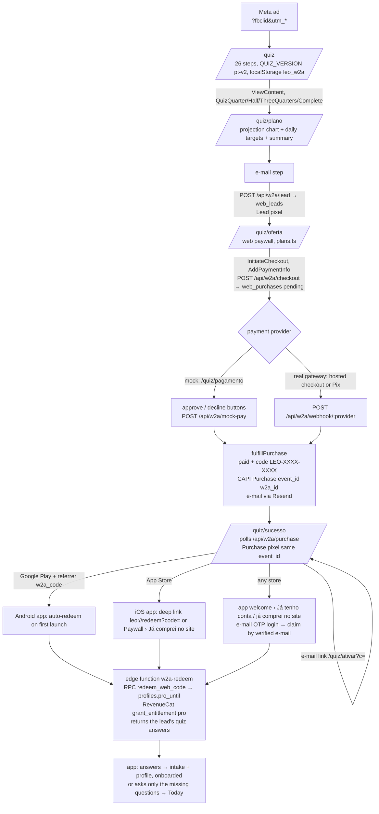

# Web2app funnel — leodiet.com/quiz

Meta ad → quiz (PT-BR) → personalized plan → e-mail → web paywall → payment → code → app download → app redeems the code.

Status (2026-10-27): built on branch `web2app` (this repo) + `web2app-redeem` (repo `leo`). **No payment gateway yet**: the
`mock` provider simulates the gateway. Not merged, not live. The `/lp-*` landings are untouched.

## Flow



Why the entitlement is granted at **redemption**, not at payment: the RevenueCat app user id is the app's Supabase user
id (anonymous until the user signs in), which doesn't exist when the person pays on the web. Granting to a placeholder
id would force a `Purchases.logIn` and break the anonymous-session design. So the code is the bridge: it attaches the
purchase to whatever user the app has at that moment (up to 3 users per code → 3 phones / re-installs).

## Files

**This repo (carnivoresystem-web)**

| File | What |
|---|---|
| `middleware.ts` | `/quiz/*` gets header `x-w2a: 1` (layout: pt-BR, no site header). `/` rewrite for leodiet.com unchanged. |
| `app/layout.tsx` | reads `x-w2a`. |
| `app/quiz/layout.tsx` | metadata (noindex), theme color, `FunnelBoot` (pixel). |
| `app/quiz/page.tsx` | quiz. |
| `app/quiz/plano/page.tsx` | plan screen + e-mail step. |
| `app/quiz/oferta/page.tsx` | web paywall. |
| `app/quiz/pagamento/page.tsx` | mock checkout (only while `W2A_PAYMENT_PROVIDER=mock`). |
| `app/quiz/sucesso/page.tsx` | confirmation, code, store buttons, deep link, e-mail me the code. |
| `app/quiz/ativar/page.tsx` | `/quiz/ativar?c=CODE` — the link in the e-mail. |
| `components/w2a/*` | UI: `ui.tsx` (building blocks), `quiz.tsx`, `plan.tsx`, `paywall.tsx`, `mock-checkout.tsx`, `success.tsx`, `activate.tsx`. |
| `lib/web2app/quiz.ts` | **the questions** (`STEPS`), milestones, validation. Bump `QUIZ_VERSION` when you change them. |
| `lib/web2app/plans.ts` | **prices** (BRL, cents). Edit here; the server re-reads them on checkout (the browser never sets the price). |
| `lib/web2app/projection.ts` | weight projection (conservative: 0.5–0.9 %/week, capped 0.9 kg/week, slows at the end, BMI floor 18.5) + daily water/sodium (mirrors the app's `computeTargets`). |
| `lib/web2app/state.ts` | funnel state in localStorage `leo_w2a` + first-touch attribution (fbclid → fbc, `_fbp`, utm_*). |
| `lib/web2app/pixel.ts` | Meta Pixel (loads only on `*.leodiet.com`, or anywhere with `?pixel=1`). |
| `lib/web2app/links.ts` | App Store / Play (with `w2a_code` referrer) / deep link URLs. |
| `lib/web2app/payments/types.ts` | **`PaymentProvider` interface**. |
| `lib/web2app/payments/mock.ts` | mock provider. |
| `lib/web2app/payments/index.ts` | provider registry (`W2A_PAYMENT_PROVIDER`), mock blocked in production. |
| `lib/web2app/server/fulfill.ts` | the one place a purchase becomes paid (idempotent): code, CAPI, e-mail. Refund TODO. |
| `lib/web2app/server/capi.ts` | Conversions API Purchase (`event_id = w2a_<purchaseId>`, same as the browser pixel → deduplicated). |
| `lib/web2app/server/email.ts` | code e-mail (Resend, from `leo@leodiet.com`). |
| `lib/web2app/server/db.ts` | Supabase PostgREST with the service role (server only). |
| `app/api/w2a/lead` | POST: create/update the lead. |
| `app/api/w2a/checkout` | POST: pending purchase + `provider.createCheckout()`. |
| `app/api/w2a/purchase` | GET `?pid&t`: purchase status for the buyer's browser (token-checked). |
| `app/api/w2a/mock-pay` | POST: mock approve/decline (refused unless provider = mock). |
| `app/api/w2a/email-code` | POST: (re)send the code, max 5, can correct the e-mail. |
| `app/api/w2a/webhook/[provider]` | POST: gateway webhooks → `provider.parseWebhook()` → fulfill / mark. |

**Repo leo (branch `web2app-redeem`)**

| File | What |
|---|---|
| `supabase/migrations/20261027000000_web2app.sql` | `web_leads`, `web_purchases`, `web_redemptions` (RLS on, no policies: service role only), RPC `redeem_web_code`. **Already applied to prod.** |
| `supabase/functions/w2a-redeem/index.ts` | redeem endpoint (user JWT). **Already deployed.** Grants `profiles.pro_until` + RevenueCat entitlement `pro` (API v2, promotional grant, `expires_at` = plan end; lifetime = 2100-01-01). |
| `src/lib/webRedeem.ts` | app client: normalize, redeem, e-mail claim (`claimWebPurchases`), pending code from the install referrer. |
| `src/lib/webProfile.ts` | quiz answers → `settings.intake` + `settings.profile` (mapping below); `applyWebAnswers` never touches an onboarded install. |
| `src/app/redeem.tsx` | "Ativar compra do site" modal (`leo://redeem?code=`; paywall footer "Já comprei no site"); success on a fresh install applies the answers. |
| `src/app/onboarding.tsx` | welcome screen (first launch: "Começar" + "Já tenho conta / já comprei no site" → e-mail OTP → claim); `mode=complete&ask=…` asks only missing questions. |
| `src/app/_layout.tsx` | `/redeem` allowed through onboarding/paywall gates; Android auto-redeem after reading the referrer, then applies the answers; claim safety net for signed-in non-Pro users. |
| `src/lib/attribution.ts` | reads `w2a_code` from the Play install referrer. |

## Data

- `web_leads`: e-mail, name, quiz answers (jsonb), computed plan, attribution (fbclid/fbc/fbp/utm/landing/referrer/IP/UA), `marketing_ok`.
- `web_purchases`: plan, amount, provider + `provider_ref`, status (`pending|paid|failed|refunded|canceled`), `test`, `access_token` (lets the buyer's browser read the status), `code`, `redemptions/max_redemptions`, CAPI and e-mail bookkeeping.
- `web_redemptions`: one row per (purchase, app user): platform, app version, `pro_until`, RevenueCat result.

## App side: e-mail claim and profile from the quiz

- `w2a-redeem` has two modes. `{code}`: as before. `{claim: true}`: needs a signed-in, **verified** (non-anonymous, `email_confirmed_at`) user; finds every `paid` `web_purchases` row whose e-mail matches case-insensitively, redeems each through `redeem_web_code` (same idempotency and 3-users limit), grants RevenueCat once with the longest `pro_until`. Results: `ok` (`already` when this user had redeemed), or `none | used | refunded | unverified`.
- Both modes return `answers` + `quiz_version`: the purchase's lead, else the newest lead with the same e-mail.
- No purchase on the e-mail: the user stays signed in, sees a friendly message and continues to the normal onboarding (a returning account that is already onboarded goes home).
- Apple "Hide my e-mail" addresses won't match the e-mail used on the web: those buyers use the code.

Mapping (web quiz id → app), source of truth `leo/src/lib/webProfile.ts`:

| Web answer | App field |
|---|---|
| `activity` sedentary / light / moderate / active | `profile.training` none / none / moderate / heavy |
| `salt` table / fine-sea / coarse / kosher / none | `profile.saltType` (same ids) |
| `tenure` never / restart / new / months / veteran | `intake.tenure` not-started / not-started / under-4w / 1-6m / over-6m → `profile.tenure` new (first two) or adapted |
| `sex` | `intake.sex` |
| `weightKg` | `profile.weightKg` |
| `symptoms` (app preset ids, "none" = empty) | `intake.symptoms`; cramps → `profile.crampsOften` |
| `goal` lose / energy / cravings / digestion / health / muscle | `intake.goals` weight / energy / discipline / digestion / inflammation / energy |
| `targetKg` vs `weightKg` (±1 kg), goal muscle | `intake.weightGoal` lose / maintain / gain |
| `blockers` sweets / weekends / symptoms / consistency, no-results | `intake.struggles` cravings / weekends / symptoms / consistency |
| `pastDiets` (anything but none) | `intake.triedBefore` |
| `commit` 7 / 30 / 90 | `intake.commitDays` 7 / 30 / 30 |
| — | `intake.source = 'web'` |

`computeTargets` needs training, tenure, salt, weight, sex and symptoms. If any is missing (pt-v1 leads had no salt/symptoms, or no lead at all) the app opens `/onboarding?mode=complete&ask=…` with only those questions, then Today. Quiz ids must stay in sync with the app; bump `QUIZ_VERSION` when they change.

Quiz answers are health data: they stay in Supabase and are **never** sent to Meta (CAPI gets hashed e-mail, external_id, country, fbc/fbp/IP/UA and the value only).

## Env vars (Vercel)

| Var | Needed | Notes |
|---|---|---|
| `SUPABASE_URL` | yes | Leo project. |
| `SUPABASE_SERVICE_ROLE_KEY` | yes | server only (never `NEXT_PUBLIC_`). |
| `RESEND_API_KEY` | yes | domain leodiet.com is verified. |
| `W2A_EMAIL_FROM` | no | default `LeoDiet <leo@leodiet.com>`. |
| `W2A_PAYMENT_PROVIDER` | yes | `mock` today; the real provider id later. |
| `W2A_ALLOW_MOCK_IN_PRODUCTION` | no | `1` would allow the mock on the production deployment. **Never set it.** |
| `META_CAPI_TOKEN` | for CAPI | same token as the app's `meta-capi` function (dataset/pixel 1370037514985006). Without it the browser pixel still works. |
| `META_TEST_EVENT_CODE` | no | only for testing in Events Manager › Test events. Test purchases go to CAPI **only** when it is set. |
| gateway keys | later | e.g. `W2A_<GATEWAY>_SECRET`, webhook secret. |

**Not set on Vercel yet** (2026-10-27): without them the preview shows the quiz, plan and paywall, but the e-mail step fails (no DB). To enable the preview (values from `~/.config/33web/supabase.env`, nothing printed):

```bash
set -a; . ~/.config/33web/supabase.env; set +a
for v in SUPABASE_URL SUPABASE_SERVICE_ROLE_KEY RESEND_API_KEY; do printf '%s' "${!v}" | vercel env add $v preview web2app; done
printf mock | vercel env add W2A_PAYMENT_PROVIDER preview web2app
vercel redeploy <preview url>   # or push a commit
```

Production has none of them yet.

## Pixel / CAPI rules

- Browser: `ViewContent` (quiz start), custom `QuizQuarter/QuizHalf/QuizThreeQuarters/QuizComplete`, `Lead` (eventID `lead_<id>`), `InitiateCheckout` (paywall view), `AddPaymentInfo` (Continuar), `Purchase` with value/currency (eventID `w2a_<purchaseId>`).
- Server: CAPI `Purchase` with the same `event_id` → Meta deduplicates.
- Test purchases (mock provider, `web_purchases.test = true`): the browser Purchase fires only with `?pixel=1` in the funnel URL (sessionStorage flag), and CAPI only when `META_TEST_EVENT_CODE` is set. No fake purchase reaches the real dataset by accident.
- The pixel loads only on `*.leodiet.com` (or with `?pixel=1`), so preview deploys stay quiet.

## The provider interface

```ts
// lib/web2app/payments/types.ts
interface PaymentProvider {
  id: string;                 // "mock", "stripe", "pagarme", ...
  test: boolean;              // purchases made with it are flagged test
  createCheckout(input: {     // called by POST /api/w2a/checkout
    purchaseId: string; accessToken: string; plan: Plan; email: string; name?: string | null;
    origin: string; successUrl: string; cancelUrl: string;
  }): Promise<{ providerRef?: string; action: { kind: "redirect"; url: string } | { kind: "pix"; qrCode: string; copyPaste: string; expiresAt: string } }>;
  parseWebhook(req: Request): Promise<{ purchaseId?: string; providerRef?: string; status: "paid"|"failed"|"refunded"|"canceled"|"pending"; providerStatus?: string } | null>;
  fetchStatus?(p: { purchaseId: string; providerRef: string | null }): Promise<{ status: ...; providerStatus?: string } | null>;
}
```

### Plugging in a real gateway

1. `lib/web2app/payments/<gateway>.ts` implementing `PaymentProvider`:
   - `createCheckout`: create the charge/checkout session with `amount = plan.priceCents`, currency BRL, **one-time** (not a subscription), `metadata.purchase_id = purchaseId`, success URL = `successUrl` (already `/quiz/sucesso?pid&t`). Return `{ kind: "redirect", url }` for a hosted checkout, or `{ kind: "pix", ... }` for a Pix QR.
   - `parseWebhook`: **verify the signature** with the gateway's webhook secret, map its events to `paid / failed / refunded / canceled`, return `purchaseId` from metadata (or `providerRef`).
   - `fetchStatus` (optional): lets `/api/w2a/purchase` confirm a payment if the webhook is late.
2. Register it in `lib/web2app/payments/index.ts` (`providerById`).
3. Pix QR: render it on `/quiz/pagamento` (TODO(gateway) in `components/w2a/paywall.tsx` and `mock-checkout.tsx`) and keep polling `/api/w2a/purchase`.
4. Webhook URL to configure in the gateway: `https://leodiet.com/api/w2a/webhook/<provider id>`.
5. Refunds: implement the TODO in `markPurchase()` (`lib/web2app/server/fulfill.ts`): revoke the RevenueCat grant for every `web_redemptions.user_id` (`POST /v2/projects/proj669b6a77/customers/<user>/actions/revoke_granted_entitlement`) and clear `profiles.pro_until`. Until then a refunded code can't be redeemed again, but users who already redeemed keep Pro until expiry.
6. Env: `W2A_PAYMENT_PROVIDER=<id>` + the gateway keys, on Production.
7. Adjust copy that depends on the gateway: "Pix ou cartão" (paywall), "No Pix, assim que o banco confirmar" (success).

## Testing

Local: `npm run dev` (port 3107 in the launcher), open `/quiz?fbclid=TEST&utm_source=fb`, finish the quiz, use a `@resend.dev` test address (`delivered@resend.dev`), pick a plan, "Simular pagamento aprovado". Test codes unlock the app for **24 h** only.
Pixel test: add `?pixel=1` to the first URL and set `META_TEST_EVENT_CODE`.
App: a dev build with the `web2app-redeem` branch, Paywall › "Já comprei no site", or `xcrun simctl openurl booted "leo://redeem?code=LEO-XXXX-XXXX"` on a fresh install (lands on Today configured). E-mail claim: fresh install → welcome › "Já tenho conta / já comprei no site" → OTP with the e-mail used on the web.

## Launch checklist

**Decisions / inputs (Victor)**
- [ ] Gateway (Pix + card, one-time charges, webhooks with signature). Then implement it as above.
- [ ] Prices in `lib/web2app/plans.ts` (today: 3 meses R$39,90 · 12 meses R$79,90 · vitalício R$119,90). Strike-through "no app" prices must be the real store prices (CDC/Procon: no fake "de/por"). The app has no annual plan in BR; the web annual has no comparison price on purpose.
- [ ] Store links: confirm App Store id 6808867448 and Play package `dev.thirtythreeweb.leo` in `lib/web2app/links.ts`.
- [ ] Resend sender `leo@leodiet.com` (domain verified) — confirm the address receives replies.

**App release (required before any ad traffic)**
- [ ] Merge `web2app-redeem` in `leo`, then a **store build** (iOS `deploy:ios` + Android) — the redeem screen touches the paywall and onboarding gained a welcome screen, so per policy it is not an OTA. Until that build is live, buyers have no way to activate.
- [ ] Android auto-redeem needs the new build too (reads `w2a_code` from the referrer).

**Production env**
- [ ] Vercel Production: `SUPABASE_URL`, `SUPABASE_SERVICE_ROLE_KEY`, `RESEND_API_KEY`, `META_CAPI_TOKEN`, `W2A_PAYMENT_PROVIDER=<gateway>`, gateway keys. Do **not** set `W2A_ALLOW_MOCK_IN_PRODUCTION`.
- [ ] Merge `web2app` → main (the `/lp-*` landings are unchanged by this branch).
- [ ] One real purchase with a real card at the lowest price, refund it, check: code e-mail, CAPI Purchase in Events Manager (deduplicated with the browser event), redeem on iOS and Android, refund flow.

**Legal / store policy**
- [ ] Terms (`/terms`): web purchases are one-time, no auto-renewal, access via code, up to 3 devices, **7-day withdrawal right (CDC art. 49)** with full refund, how to ask (leo@leodiet.com), seller 33WEB SOFTWARE LTDA + CNPJ.
- [ ] Privacy (`/privacy`): the quiz collects health-related answers (weight, height, sleep, cravings…), stored in Supabase to build the plan and support the purchase; not shared with ad platforms; Meta Pixel/CAPI receive hashed e-mail and the purchase value; LGPD rights + deletion contact.
- [ ] Health claims: the quiz and plan say "estimativa", never promise results, and show the disclaimer (hypertension, kidney/heart disease, pregnancy, medication). Keep it that way in ads too.
- [ ] Apple/Google: buying outside the app and unlocking with a code is a "reader"/multiplatform-style flow; the app does **not** link to the web checkout or mention web prices (keep it that way — guideline 3.1.1 / Play payments policy). The "Já comprei no site" entry only redeems.

**Meta (suggestion, nothing created)**
- [ ] New campaign, objective **Sales**, conversion location Website, dataset 1370037514985006, optimize for **Purchase**, destination `https://leodiet.com/quiz` with `utm_source=meta_br&utm_campaign=w2a_...`. Separate from the running lp-pt campaign so the two can be compared; start ABO R$30–50/day, broad BR 25–55, reuse the best lp-pt creatives. If Purchase volume is too low for the first week, optimize for Lead or InitiateCheckout, then switch.

**Reporting caveat**
- RevenueCat sees web buyers as promotional grants (no revenue in RC charts). Web revenue = `web_purchases` (status paid, test false).
